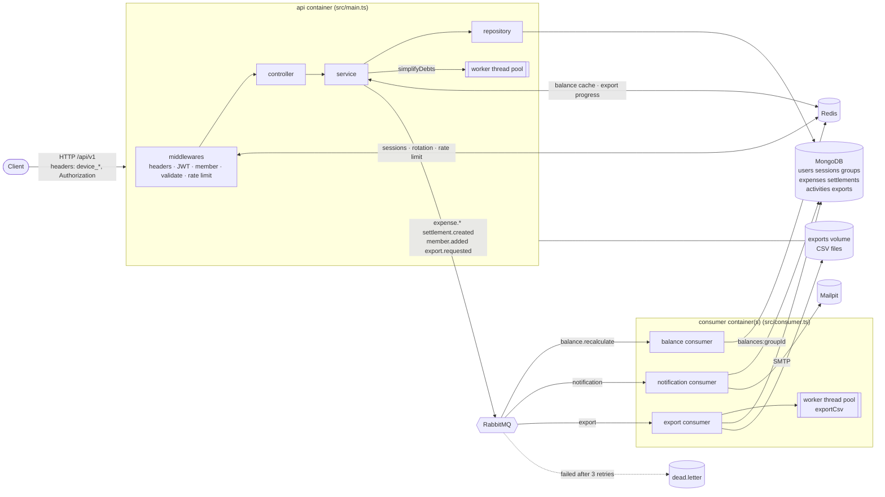

# SplitEase

A Splitwise-style REST API for sharing group expenses. Users form groups, add shared expenses (equal, exact or
percentage splits), see who owes whom, get a simplified settle-up plan, record settlements and export a group's
history as CSV. Heavy work runs in the background.

**Stack:** Express + TypeScript (strict, no `any`) · MongoDB (Mongoose) · Redis · RabbitMQ · Node worker threads ·
Docker · header-based JWT.

## Run it

Nothing but Docker is needed.

```bash
docker compose up --build
```

| Service   | URL / port                                   | Notes                                              |
| --------- | -------------------------------------------- | -------------------------------------------------- |
| api       | http://localhost:3000                        | `GET /health` → `{ mongo, redis, rabbitmq }`       |
| consumer  | –                                            | RabbitMQ consumers; `docker compose up --scale consumer=2` |
| mongo     | 27017                                        | volume `mongo-data`                                |
| redis     | 6379                                         |                                                    |
| rabbitmq  | 5672 · dashboard http://localhost:15672      | guest / guest                                      |
| mailpit   | SMTP 1025 · inbox http://localhost:8025      | all notification emails land here                  |

Every variable has a default in `docker-compose.yml`, so no `.env` is needed. To override anything (secrets, host
ports), copy `.env.example` to `.env`. **Change the JWT secrets for any real deployment.**

`SIGTERM` (`docker compose stop`) shuts down gracefully: the API stops accepting requests and finishes in-flight
ones; consumers stop taking messages and finish the one they are processing; then worker threads, RabbitMQ, Redis
and Mongo are closed.

### Local development (without Docker for the app)

```bash
docker compose up -d mongo redis rabbitmq mailpit
cp .env.example .env          # then point MONGO_URI / REDIS_URL / RABBITMQ_URL / SMTP_HOST at localhost
npm ci
npm run dev                   # API          (src/main.ts)
npm run dev:consumer          # consumers    (src/consumer.ts)
```

| Script                 | Purpose                          |
| ---------------------- | -------------------------------- |
| `npm run build`        | compile to `dist/`               |
| `npm test`             | unit tests (jest)                |
| `npm run lint`         | ESLint (`no-explicit-any` is an error) |
| `npm run format`       | Prettier                         |
| `npm run typecheck`    | `tsc --noEmit`                   |

## Architecture



### Layering

- **routes** wire URL → middlewares → controller. No logic.
- **controller** reads the request, calls one service method, sends the response. No database calls.
- **service** holds the business rules and publishes queue events.
- **repository** is the only place that touches Mongoose models.
- **workers** (`providers/workerThread`) receive plain data and return plain data: no database or Redis access
  inside a thread. `worker-thread.service.ts` keeps a small pool (`WORKER_POOL_SIZE`) and exposes `runTask(name, data)`.

Errors are thrown as `AppError` anywhere and turned into the error envelope in one place
(`middlewares/error.middleware.ts`); async handlers are wrapped so a rejected promise can never crash the process.

### Auth (header-based JWT)

- Login / register / refresh return `x-access-token` and `x-refresh-token` **response headers only** (never cookies
  or body); CORS exposes both.
- Access token: 15 min, `{ sub, sid }`. Refresh token: 7 days, `{ sub, sid, jti }`; only the `jti` is stored in Redis.
- `sid` is the Mongo session `_id`; one session per `(user, device_id)`. Logging in again on a device replaces its session.
- The access middleware also checks `session:<sid>` in Redis, so logout works instantly.
- **Rotation:** each refresh issues a new pair and atomically swaps the stored `jti`.
  **Reuse detection:** presenting an already-rotated refresh token deletes the session → `401 REFRESH_TOKEN_REUSED`.
- Login is rate-limited in Redis: 5 tries/minute per email + IP → `429 TOO_MANY_ATTEMPTS`.

### Background processing

| Event (published by services)                                   | Queue                | Consumer               | Result                                                         |
| --------------------------------------------------------------- | -------------------- | ---------------------- | -------------------------------------------------------------- |
| `expense.created/updated/deleted`, `settlement.created`, `member.added/removed` | `balance.recalculate` | balance consumer       | recalculates and caches `balances:<groupId>` in Redis           |
| `expense.*`, `settlement.created`, `member.added`               | `notification`       | notification consumer  | writes an `activities` document + emails group members (Mailpit) |
| `export.requested`                                              | `export`             | export consumer        | builds the CSV on a worker thread, writes the file, reports progress in Redis |

- **Stale balances:** every write bumps `balance_ver:<groupId>`; cached balances remember the version they were
  computed at. `GET /groups/:id/balances` returns the cached numbers with `stale: true` while a recalculation is
  still queued. Member removal and the settle plan always use fresh data.
- **Idempotent consumers:** each message has a `messageId`; processed ids are remembered in Redis and the activity
  upsert is keyed on it, so a redelivery never duplicates anything.
- **Retries + dead-letter queue:** a failing message is re-queued up to 3 times with a growing delay, then rejected
  to `dead.letter` (via the `dlx` exchange), where it is logged for inspection.
- **Exports:** `POST` → `202`, poll `GET /exports/:id` (`status`, `progress`), then download the CSV
  (`404` until `DONE`). Files live on the `exports-data` volume shared by `api` and `consumer`.

### Money

All amounts are integer **paise** (₹12.50 = 1250); INR only. Equal splits give leftover paise to the first members
(1000 ÷ 3 = 334, 333, 333). `PERCENT` splits are converted to paise on save using integer maths (largest remainder),
so the shares of an expense always sum to its amount exactly.
Balance = paid − shares + settlements paid − settlements received; all balances in a group sum to 0.

## API

Every endpoint is under `/api/v1`, uses JSON, and needs these headers (except `GET /health`):

| Header          | Example         | Rule                                  |
| --------------- | --------------- | ------------------------------------- |
| `device_id`     | `b7f1c2e4-9a10` | missing → `400 DEVICE_ID_REQUIRED`    |
| `device_type`   | `3`             | 1 Android, 2 iOS, 3 Web               |
| `timezone`      | `Asia/Kolkata`  | IANA name                             |
| `lang`          | `en`            | `en` or `hi`                          |
| `Authorization` | `Bearer <jwt>`  | protected routes                      |
| `x-refresh-token` | `<jwt>`       | `POST /auth/refresh` only             |

Responses: `{ statusCode, message, data }` on success, `{ statusCode, code, message, requestId }` on error.
List endpoints take `page` (1), `limit` (20, max 100), `sortBy`, `order` and return `{ items, page, limit, total, totalPages }`.

| #  | Method       | Path                                             | Auth            | What it does                                       |
| -- | ------------ | ------------------------------------------------ | --------------- | -------------------------------------------------- |
| 1  | POST         | `/auth/register`                                 | –               | Create account, log in; tokens in headers          |
| 2  | POST         | `/auth/login`                                    | –               | Log in; 5 tries/min per email + IP                 |
| 3  | POST         | `/auth/refresh`                                  | refresh         | Rotate tokens                                      |
| 4  | POST         | `/auth/logout`                                   | Auth            | End this device's session                          |
| 5  | POST         | `/auth/logout-all`                               | Auth            | End every session                                  |
| 6  | GET          | `/auth/sessions`                                 | Auth            | List active devices                                |
| 7  | GET          | `/users/me`                                      | Auth            | My profile                                         |
| 8  | PATCH        | `/users/me`                                      | Auth            | Update my name                                     |
| 9  | GET          | `/users/search?email=`                           | Auth            | Find a user by exact email                         |
| 10 | POST         | `/groups`                                        | Auth            | Create a group                                     |
| 11 | GET          | `/groups`                                        | Auth            | My groups, paginated, with my balance in each      |
| 12 | GET          | `/groups/:groupId`                               | Auth + member   | Group details and members                          |
| 13 | PATCH        | `/groups/:groupId`                               | Auth + member   | Rename                                             |
| 14 | POST         | `/groups/:groupId/members`                       | Auth + member   | Add a member by email                              |
| 15 | DELETE       | `/groups/:groupId/members/:userId`               | Auth + member   | Remove a member (balance must be 0)                |
| 16 | POST         | `/groups/:groupId/expenses`                      | Auth + member   | Add an expense (EQUAL / EXACT / PERCENT)           |
| 17 | GET          | `/groups/:groupId/expenses`                      | Auth + member   | List: page, limit, search, paidBy, from, to, sortBy, order |
| 18 | GET          | `/groups/:groupId/expenses/:expenseId`           | Auth + member   | One expense with its splits                        |
| 19 | PATCH        | `/groups/:groupId/expenses/:expenseId`           | Auth + member   | Edit; splits re-validated                          |
| 20 | DELETE       | `/groups/:groupId/expenses/:expenseId`           | Auth + member   | Soft delete                                        |
| 21 | GET          | `/groups/:groupId/balances`                      | Auth + member   | Net balance per member (Redis cache)               |
| 22 | GET          | `/groups/:groupId/settle-plan`                   | Auth + member   | Fewest payments to settle the group                |
| 23 | GET          | `/balances/me`                                   | Auth            | My totals across all groups (`totalOwe`, `totalOwed`) |
| 24 | POST         | `/groups/:groupId/settlements`                   | Auth + member   | Record a payment between two members               |
| 25 | GET          | `/groups/:groupId/settlements`                   | Auth + member   | Settlement history, paginated                      |
| 26 | GET          | `/activity`                                      | Auth            | My activity feed, newest first                     |
| 27 | POST         | `/groups/:groupId/exports`                       | Auth + member   | Request a CSV export (202)                         |
|    | GET          | `/exports/:exportId`                             | Auth + member   | Poll status + progress                             |
|    | GET          | `/exports/:exportId/download`                    | Auth + member   | Download the CSV (404 until DONE)                  |
|    | GET          | `/health`                                        | –               | `{ mongo, redis, rabbitmq }` (no headers needed)   |

### Error codes

| HTTP | Code                                           | When                                              |
| ---- | ---------------------------------------------- | ------------------------------------------------- |
| 400  | `VALIDATION_ERROR`                             | body, query or params fail the zod schema         |
| 400  | `DEVICE_ID_REQUIRED`, `DEVICE_TYPE_REQUIRED`, `TIMEZONE_REQUIRED`, `LANG_REQUIRED` | a required header is missing/invalid |
| 400  | `SPLIT_TOTAL_MISMATCH`                         | exact splits ≠ amount, or percentages ≠ 100       |
| 401  | `UNAUTHORIZED`                                 | no/invalid access token, or session revoked       |
| 401  | `TOKEN_EXPIRED`                                | access token expired → call `/auth/refresh`       |
| 401  | `REFRESH_TOKEN_REUSED`                         | a rotated refresh token was used again            |
| 403  | `NOT_GROUP_MEMBER`                             | user is not in the group                          |
| 404  | `NOT_FOUND`                                    | missing or soft-deleted resource                  |
| 409  | `EMAIL_TAKEN`, `ALREADY_MEMBER`                | duplicate                                         |
| 409  | `BALANCE_NOT_SETTLED`                          | removing a member whose balance is not 0          |
| 429  | `TOO_MANY_ATTEMPTS`                            | login rate limit                                  |

### Postman

Import [`postman/SplitEase.postman_collection.json`](postman/SplitEase.postman_collection.json). It contains every
endpoint with the device headers pre-filled, stores the tokens from the **response headers** after
register/login/refresh, and captures `userId`, `groupId`, `expenseId`, `exportId` automatically. To try
two-person flows, register a second user (change the `email` variable), copy their id into `friendId`, and add them
with *Add member*.

## Project layout

```
src/
├── main.ts · consumer.ts          # entry points: HTTP server / RabbitMQ consumers
├── app.ts · app.routes.ts         # express app + global middlewares / mounts /api/v1
├── config/configuration.ts        # env validated with zod; fails fast
├── common/                        # constants, AppError, response envelope, money + pagination helpers
├── enum/ · interfaces/ · logger/  # enums, request augmentation, winston (tokens redacted)
├── middlewares/                   # headers, access/refresh token, group member, rate limit, validate, errors
├── modules/v1/<module>/           # routes · controller · service · dto/ · interface/
│     auth user group expense balance settlement activity export
├── providers/                     # database, redis, rabbitmq, consumers, workerThread, email
├── repositories/                  # the only code that touches Mongoose models
└── schemas/                       # Mongoose schemas + indexes
```
